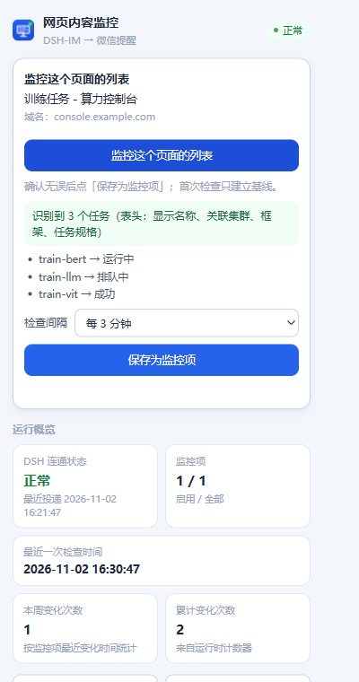
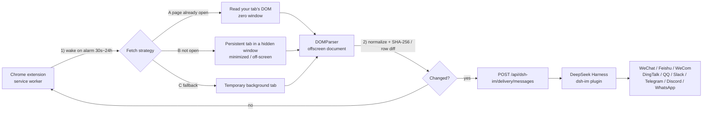
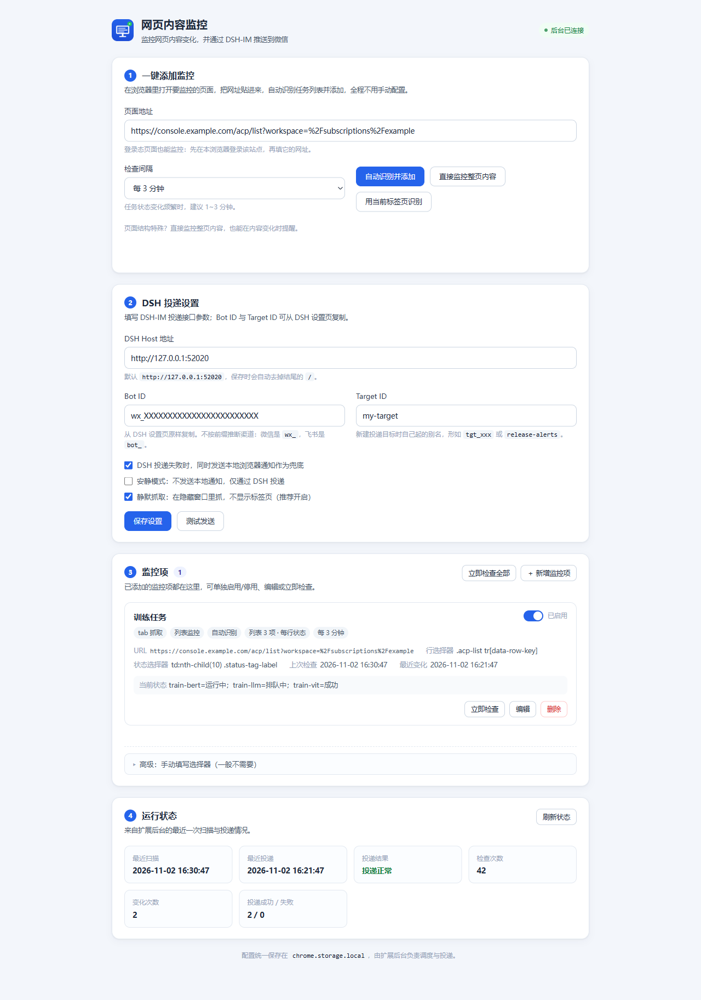

<div align="center">


# DSH Web Monitor

**Turn any web page change into a WeChat message.**

Watch a page → it changes → your phone buzzes.<br/>
No selectors to write, no cloud service, nothing leaves your machine.

[](manifest.json)
[](manifest.json)
[](https://www.google.com/chrome/)
[](https://nodejs.org/)
[](https://github.com/cls1277/dsh-web-monitor/actions/workflows/test.yml)
[](LICENSE)
[](https://github.com/cls1277/dsh-web-monitor/stargazers)

[简体中文](README.md) · **English**



</div>

---

## Table of contents

- [Why](#-why)
- [Features](#-features)
- [How it works](#-how-it-works)
- [Install](#-install)
- [Quick start](#-quick-start)
- [Usage](#-usage)
- [Configuration](#-configuration)
- [What the notifications look like](#-what-the-notifications-look-like)
- [Troubleshooting](#-troubleshooting)
- [Limitations](#-limitations)
- [Roadmap](#-roadmap)
- [Development and tests](#-development-and-tests)
- [License](#-license)

---

## ✨ Why

Hosted monitoring services want your URLs, an account and a subscription — and most of them
cannot log in to your company's internal console. Meanwhile the things you actually need to
watch live behind a login, inside a heavy SPA:

- training-job status on a GPU cloud console (queued → running → succeeded / failed)
- the status of one specific ticket
- score pages, application pages, approval pages, stock or price pages
- a notice list that gets new entries

Those pages are **SPA + authenticated**: `curl` gets an empty shell and hosted monitors are locked out.
This extension runs inside *your* Chrome, uses *your* session, reads the rendered DOM, and pushes
changes through the **[DSH-IM](https://github.com/xmanrui/dsh-im)** bot to WeChat
(also Feishu / WeCom / DingTalk / QQ / Slack / Telegram / Discord / WhatsApp).

**Local only, no account, no telemetry.** Apart from the change notification itself, page data never
leaves your computer.

## 🚀 Features

| Feature | Details |
| --- | --- |
| 🖱️ **One-click monitoring** | Click the toolbar icon on the target page → it detects the list / status column / main content → preview → save. **No selectors needed** |
| 📋 **Row-by-row diffing** | Task lists are compared as `name → status`; messages list every change: `train-bert: running → succeeded` |
| 🌐 **Works beyond tables** | No table? It falls back to "main content", and finally to "whole page content" |
| 🕶️ **Silent capture (zero window)** | If the page is already open, it reads *that* tab: no new window, no navigation, no focus stealing |
| 🩹 **Self-healing** | Page redesign broke a selector? The next check re-detects and rewrites it automatically |
| 🔁 **Retries + local fallback** | Failed delivery retries up to 3 times (60 s apart) and can fall back to a browser notification |
| 🧪 **Tested** | Node test suites plus a real-Chrome suite; `npm test` runs them all |
| 📦 **Zero deps, zero build** | Plain MV3 extension: no bundler, no CDN, no runtime dependencies |

## 🧭 How it works



Design notes:

1. **Service workers have no DOM** → parsing happens in a `chrome.offscreen` document (`DOM_PARSER`).
2. **All state lives in `chrome.storage.local`**, so service-worker eviction loses nothing; writes are serialized.
3. **Persist the new baseline before notifying** → a failed delivery never causes duplicate alerts.
4. **List mode hashes a key-sorted serialization** → row reordering doesn't produce false positives.
5. **Messages are capped at 1500 characters** → WeChat splits at 1800, and each segment costs a send quota.

## 📦 Install

### Requirements

- **Chrome 116+** (for `chrome.offscreen`)
- A running **DeepSeek Harness** instance with the **[DSH-IM](https://github.com/xmanrui/dsh-im)** plugin
  connected to at least one channel (WeChat / Feishu / WeCom / DingTalk / QQ / Slack / Telegram / Discord / WhatsApp)

### Load the extension

1. Clone the repository
   ```bash
   git clone https://github.com/cls1277/dsh-web-monitor.git
   ```
2. Open `chrome://extensions` and enable **Developer mode**
3. Click **Load unpacked** and select the repository folder
4. The options page opens automatically; later use the toolbar icon → **Open settings**

> Permissions: the extension requests `http/https://*/*`, which is what makes one-click monitoring of
> any page possible. If you prefer, narrow those two lines in `manifest.json` to your own domains and
> reload the extension.

### Configure a DSH delivery target (once)

1. Open the DeepSeek Harness web UI → **Settings → IM bots**
2. Open your bot card → gear icon → copy the **Bot ID**
3. **New target** → pick a conversation you've already chatted in (or fill the platform ID manually)
   → **Test** → **Save target**
4. Use **Copy invocation params** on that target to get `{ botId, targetId }`
5. Paste them into the extension options (**DSH URL + Bot ID + Target ID**) → click **Send test**

> Details and the full error-code table: [docs/dsh-im-delivery.md](docs/dsh-im-delivery.md) (Chinese).
> WeChat note: proactive sends depend on the latest `context_token`; if you hit
> `ret=-2 prepare failed`, send the bot any message and retry.

## ⚡ Quick start

1. Open the page you want to watch in Chrome (stay logged in, wait for the list to render)
2. Click the toolbar icon → **"Monitor this page's list"**
3. Review the result (`N tasks` + a few `task → status` samples) → pick an interval (default 3 min) → **Save**
4. The first check only records a baseline; after that, every change reaches WeChat



**Want absolutely no visible window?** Keep that page open in Chrome (pinning the tab is a good idea).
The extension reads your tab directly — zero new windows. Only when the tab is gone does it fall back
to a hidden window.

## 🖱️ Usage

### One-click monitoring (recommended)

- **Popup**: click the icon on the target page → auto-detect → preview → save
- **Options page**: paste a URL → **Auto-detect and add**
- Detection order: list → main content → if both fail, use **"Monitor the whole page"**
- Failures return a Chinese explanation plus diagnostics (`tables`, `trs`, HTML length) with a copy button

### Advanced: manual selectors (rarely needed)

The **"Advanced: manual selectors"** block in options is collapsed by default:

| Mode | Use for | Required |
| --- | --- | --- |
| **single** | notice titles, numbers, article bodies | a selector (CSS or XPath) + value kind (text/HTML/attribute) |
| **rows** | status columns of task/ticket lists | row selector + status selector (row-relative CSS); key selector optional |

List mode extras: `key attribute` (e.g. `data-row-key`), `only these statuses` (`succeeded,failed`),
`notify on new rows` (on by default), `notify on removed rows` (off by default, avoids pagination noise).

### Fetch strategies and silence

| Order | Strategy | Behaviour | Visible window |
| --- | --- | --- | --- |
| 1 | **Read your open tab** | No new window, no navigation, no focus stealing | **None at all** |
| 2 | Hidden window | Persistent tab in a minimized / off-screen window | Possibly one hidden window |
| 3 | Temporary tab | Background tab, closed right after reading | Brief tab flash |
| 4 | `direct` | Plain `fetch` of the HTML (non-tab mode) | None at all |

If strategy 1 yields unusable content (you're on a different filter, session expired), the extension
automatically retries with strategy 2. The strategy used is recorded in `status.lastStrategy`.

## ⚙️ Configuration

### Global settings

| Field | Default | Description |
| --- | --- | --- |
| `dshBaseUrl` | `http://127.0.0.1:52020` | DSH web host URL, no trailing slash (use the address printed at startup) |
| `botId` | — | Bot ID from DSH settings (WeChat uses `wx_`, Feishu uses `bot_`, don't guess by prefix) |
| `targetId` | — | Your alias for the delivery target (e.g. `my-target`) |
| `localFallback` | `true` | Show a browser notification when DSH delivery fails |
| `quiet` | `false` | Deliver only, no local notifications |
| `silentTabs` | `true` | Silent capture (reuse your tab / hidden window) |

### Watches

| Field | Description |
| --- | --- |
| `mode` | `direct` (fetch HTML) or `tab` (rendered DOM; required for authenticated SPAs) |
| `extractMode` | `single` (one value) or `rows` (list, row by row) |
| `intervalMinutes` | 0.5 – 1440 minutes (Chrome alarms floor is 30 s) |
| `autoDetect` | `true` for one-click watches: re-detect and rewrite selectors when they break |
| `waitForSelector` | In tab mode, wait for this element (up to 25 s) |
| `settleMs` | Extra wait after load (0 – 20000 ms) for SPA rendering |
| `onlyStatuses` | List mode: only notify when the new status is one of these (comma separated) |

## 💬 What the notifications look like

List mode (row-level status changes):

```
【任务状态变化】训练任务
页面：https://console.example.com/acp/list?workspace=...
时间：2026-11-02 15:20:11
• train-bert：运行中 → 成功
• train-llm：排队中 → 运行中
（共 2 项变化）
```

Single-value mode: `【内容变更】…` with before/after previews. Messages are capped at 1500 characters.

## 🩺 Troubleshooting

| Symptom | Cause | Fix |
| --- | --- | --- |
| `no rows extracted (0 elements matched)` | still using `direct` (SPA shell only), or the positional selector broke | switch to `tab`, or use one-click detection |
| `N rows matched, but the status selector extracted nothing` | column order changed / checkbox column picked | use the cell texts printed in the error to fix the column index, or use a stable class like `.status-tag-label` |
| `page requires login` | your Chrome session expired | log in again in Chrome, then click "Check now" |
| `timed out waiting for selector` | page renders slowly / wrong wait selector | increase the extra wait, or use a more stable selector |
| `unknown-bot` / `unknown-target` | wrong Bot ID / Target ID, or no target created yet | copy again from DSH settings; create and test a target first |
| `bot-not-connected` | bot offline | wait for reconnection (the extension retries 3 times) |
| `delivery-failed` with WeChat `ret=-2` | `context_token` expired | send the bot a message, then retry the test |
| `cannot reach DSH` | DSH not running / port changed | start DSH and match the address/port |

On failure the popup offers **"Copy diagnostics"** — paste that JSON into an
[issue](https://github.com/cls1277/dsh-web-monitor/issues).
Selector troubleshooting for three-layer micro-frontend sites:
[docs/selector-troubleshooting.md](docs/selector-troubleshooting.md) (Chinese).

## ⚠️ Limitations

- **Chrome cannot render a page without a window.** True zero-window capture relies on the page being
  open in your browser; otherwise a hidden (minimized / off-screen) window is used. That's a browser
  constraint, not a design shortcut.
- **Not a cloud service**: your computer, Chrome and DSH must be running. While the machine sleeps
  nothing is checked (one catch-up check runs after wake).
- **List mode only sees the current DOM page**: paginating or changing filters looks like
  "old rows gone, new rows appeared". Removed-row notifications are off by default; prefer a larger
  page size and staying on page 1.
- **Text only**: DSH-IM proactive delivery has no image/card support; each message ≤ 1500 characters.
- **Session = this Chrome profile.** A different profile needs to log in again.
- **Minimum interval is 30 s** (Chrome `alarms`), and heavy pages deserve longer intervals.

## 🗺️ Roadmap

- [ ] On-page element picker (click the region you want to watch)
- [ ] Change history and timeline
- [ ] Attach a page screenshot to the notification
- [ ] Fan out one watch to multiple targets / channels
- [ ] Cron-style schedules (e.g. only weekdays 9-18)
- [ ] API mode for known sites (skip DOM rendering, lower overhead)

## 🛠 Development and tests

```bash
npm test                   # pure functions + background integration (no deps, Node ≥ 20)
node tools/selftest.mjs    # extraction/diff/copy-length/repo sanity
node tools/integration.mjs # mocked chrome.* + local HTTP, full background pipeline
```

Optional (needs local Chrome plus `puppeteer-core`):

```bash
npm i -D puppeteer-core
node tools/browser-e2e.mjs # real Chrome: DOM extraction, table detection, SenseCore fixture
```

| Path | Role |
| --- | --- |
| `src/background.js` | scheduling, fetch strategies, diffing, delivery, retries, self-healing |
| `src/extract.js` | pure helpers: normalize / SHA-256 / extraction / row diff / message templates |
| `src/detect.js` | self-contained functions injected into pages (list + main content detection) |
| `src/offscreen.js` | `DOMParser` offscreen document |
| `src/options.*`, `src/popup.*` | vanilla-JS UI, no build step |
| `docs/architecture.md` | module contract: storage shape, message protocol, message templates |
| `docs/dsh-im-delivery.md` | measured DSH-IM delivery API and configuration guide |
| `docs/sensecore-dom-research.md` | DOM research on a real micro-frontend console |
| `docs/selector-troubleshooting.md` | "nothing is detected" troubleshooting guide |

Read [CONTRIBUTING.md](CONTRIBUTING.md) before opening a PR. CI runs on GitHub Actions (Node 20 / 22).

## 📄 License

[MIT](LICENSE) © 2026 cls1277

If this saved you some page-refreshing, a ⭐ is the best thanks.

<a href="https://star-history.com/#cls1277/dsh-web-monitor&Date">
  
</a>
