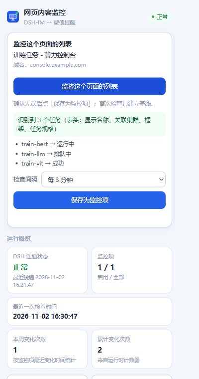
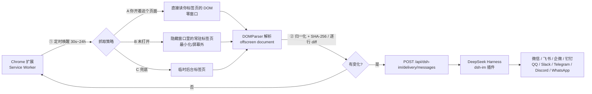
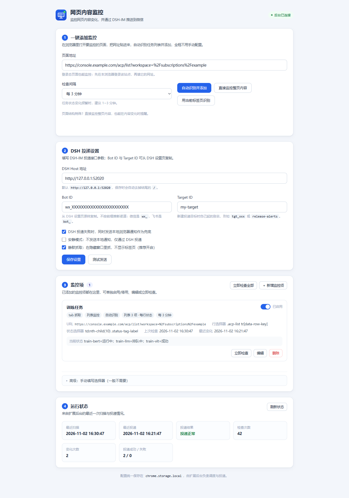

<div align="center">


# DSH Web Monitor

**把网页上的任何变化，变成一条微信消息。**

盯住一个页面 → 发生变化 → 微信立刻收到通知。<br/>
无需写选择器，无需云服务，数据不离开你的电脑。

[](manifest.json)
[](manifest.json)
[](https://www.google.com/chrome/)
[](https://nodejs.org/)
[](https://github.com/cls1277/dsh-web-monitor/actions/workflows/test.yml)
[](LICENSE)
[](https://github.com/cls1277/dsh-web-monitor/stargazers)

**简体中文** · [English](README.en.md)



</div>

---

## 目录

- [为什么需要它](#-为什么需要它)
- [功能亮点](#-功能亮点)
- [工作原理](#-工作原理)
- [安装](#-安装)
- [快速开始](#-快速开始)
- [用法详解](#-用法详解)
- [配置参考](#-配置参考)
- [通知长什么样](#-通知长什么样)
- [排错](#-排错)
- [已知限制](#-已知限制)
- [Roadmap](#-roadmap)
- [开发与测试](#-开发与测试)
- [License](#-license)

---

## ✨ 为什么需要它

现有方案要么是云端服务（把页面 URL 交给第三方、按次收费、要注册账号），要么让你在网页里
用鼠标划区域（页面一改版就失效）。而真正需要盯的东西往往在**登录态的企业后台**里：

- 算力平台的训练任务状态（排队中 → 运行中 → 成功/失败）
- 工单系统里某张工单的状态
- 成绩、报名、审批、库存、价格页面
- 公告列表有没有新条目

这些页面通常是 **SPA + 登录态**：`curl` 抓不到、云端监控也进不去。
本扩展跑在你自己的 Chrome 里，用你已有的登录态读取渲染后的页面，
再把「变化」通过 **[DSH-IM](https://github.com/xmanrui/dsh-im)** 机器人推送到微信
（也支持飞书 / 企微 / 钉钉 / QQ / Slack / Telegram / Discord / WhatsApp）。

**纯本地、无账号、无遥测**：除了「变化通知」本身，页面数据不会离开你的电脑。

## 🚀 功能亮点

| 能力 | 说明 |
| --- | --- |
| 🖱️ **一键监控** | 在目标页面点扩展图标 → 自动识别列表/状态列/主要内容 → 预览 → 保存。**不用写任何选择器** |
| 📋 **列表逐行对比** | 任务列表按「名称 → 状态」逐行比对，消息里逐条列出：`train-bert：运行中 → 成功` |
| 🌐 **通用内容监控** | 没有表格也能用：自动退成「页面主要内容」；识别不了还有「监控整页内容」兜底 |
| 🕶️ **静默抓取（零窗口）** | 页面本来就开着 → 直接读你那个标签页，**不新建窗口、不导航、不抢焦点** |
| 🩹 **自愈** | 页面改版导致选择器失效？下次检查自动重新识别并回填，不会静默失联 |
| 🔁 **失败重试 + 本地兜底** | 投递失败自动重试 3 次（60s 间隔），同时可弹浏览器本地通知 |
| 🧪 **可测试** | Node 测试 + 真实 Chrome 测试，`npm test` 一条命令跑完 |
| 📦 **零依赖零构建** | 原生 MV3 扩展：没有打包器、没有 CDN、没有第三方运行时依赖 |

## 🧭 工作原理



关键设计：

1. **Service Worker 里没有 DOM** → 用 `chrome.offscreen` 的 `DOM_PARSER` 文档解析 HTML。
2. **状态全部持久化在 `chrome.storage.local`**，Service Worker 被回收也不丢；写操作串行化。
3. **先落盘新基线，再发通知** → 发送失败不会导致下一轮重复提醒。
4. **列表模式先排序序列化再算指纹** → 行顺序变化（排序）不会误报。
5. **消息控制在 1500 字** → 微信按 1800 字符分段，超长会占用多次发送额度。

## 📦 安装

### 前置条件

- **Chrome 116+**（需要 `chrome.offscreen`）
- 一个跑着 **[DSH-IM](https://github.com/xmanrui/dsh-im)** 插件、并已接入至少一个渠道
  （微信/飞书/企微/钉钉/QQ/Slack/Telegram/Discord/WhatsApp）的 **DeepSeek Harness**（本机运行）

### 加载扩展

1. 克隆本仓库
   ```bash
   git clone https://github.com/cls1277/dsh-web-monitor.git
   ```
2. 打开 `chrome://extensions` → 右上角开启 **开发者模式**
3. 点 **加载已解压的扩展程序** → 选择仓库目录
4. 首次安装会自动打开设置页；之后点工具栏图标 → **打开设置**

> 权限说明：扩展申请了 `http/https://*/*` 访问权限，「一键监控任意页面」才不用每次授权。
> 不想给全站权限？把 `manifest.json` 里这两行收窄成你要监控的域名，重新加载即可。

### 配置 DSH 投递目标（一次性）

1. 打开 DeepSeek Harness 的 Web 界面 → **设置 → IM机器人**
2. 找到你的机器人卡片 → 右上角 **齿轮** → 复制 **Bot ID**
3. **新建目标** → 从已聊过的会话里选（或手动填平台 ID）→ **测试** → **保存目标**
4. 在该目标上 **复制调用参数**，得到 `{ botId, targetId }`
5. 填进扩展设置页：**DSH 地址 + Bot ID + Target ID** → 点 **测试发送**，微信收到即通

> 细节与错误码见 [docs/dsh-im-delivery.md](docs/dsh-im-delivery.md)（中文）。
> 微信渠道注意：主动发送依赖最近的 `context_token`；若收到 `ret=-2 prepare failed`，
> 给机器人随便发一条消息再重试即可。

## ⚡ 快速开始

1. 在 Chrome 里打开要监控的页面（登录态页面保持登录、等列表加载出来）
2. 点工具栏图标 → **「监控这个页面的列表」**
3. 看到识别结果（`识别到 N 个任务` + 前几条 `任务名 → 状态`）→ 选间隔（默认 3 分钟）→ **保存为监控项**
4. 首次检查只建立基线，**不会打扰你**；之后状态一变，微信立刻收到



**想完全看不到窗口？** 检查期间把那个页面留在 Chrome 里开着即可（建议钉在标签栏）。
扩展会直接读你的标签页，零新窗口；只有该标签页被关掉时才会退回隐藏窗口方式。

## 🖱️ 用法详解

### 一键监控（推荐）

- **popup 入口**：目标页面点扩展图标 → 自动识别 → 预览 → 保存
- **设置页入口**：填 URL → **自动识别并添加**
- 识别逻辑：先找「列表」→ 否则找「页面主要内容」→ 都不行就提示你点 **「直接监控整页内容」**
- 失败场景会给中文原因 + 诊断信息（table/tr 数量、HTML 长度），一键复制反馈

### 高级：手动配置（一般不需要）

设置页里 **「高级：手动填写选择器（一般不需要）」** 默认折叠，支持完全自定义：

| 模式 | 适用 | 必填 |
| --- | --- | --- |
| **单值 `single`** | 公告标题、数字、文章正文 | 选择器（CSS 或 XPath）+ 取值方式（文本/HTML/属性） |
| **列表 `rows`** | 任务/工单列表的状态列 | 行选择器 + 状态选择器（行内相对 CSS），行键选择器可留空 |

列表模式还支持：

- `行键属性名`（如 `data-row-key`，用行主键当键，天然唯一）
- `只看这些状态`（如 `成功,失败`，只有变成这些状态才提醒）
- `新出现的行也提醒`（默认开）、`消失的行也提醒`（默认关，避免分页/排序误报）

### 抓取方式与「静默」

| 顺序 | 策略 | 行为 | 可见窗口 |
| --- | --- | --- | --- |
| 1 | **读你已打开的标签页** | 不新建窗口、不导航、不抢焦点 | **完全没有** |
| 2 | 隐藏窗口 | 屏幕外/最小化窗口里的常驻标签页 | 可能有一个隐藏窗口 |
| 3 | 临时标签页 | 后台标签页，读完即关 | 会闪一下 |
| 4 | `direct` | 直接 `fetch` HTML（非 tab 模式） | 完全没有 |

- 策略 1 读到的内容对不上（你停在别的筛选/掉登录）时，自动用策略 2 重新导航一次。
- 实际使用的策略记录在监控项状态里（`lastStrategy`），排错时有用。
- 删除/停用所有监控项后，隐藏窗口会自动关闭。

## ⚙️ 配置参考

### 全局设置

| 字段 | 默认 | 说明 |
| --- | --- | --- |
| `dshBaseUrl` | `http://127.0.0.1:52020` | DSH Web Host 地址（不带结尾 `/`），以 Host 启动时显示的地址为准 |
| `botId` | — | DSH 设置页「调用标识」复制的机器人 ID（微信 `wx_`、飞书 `bot_`，不要按前缀猜渠道） |
| `targetId` | — | 你为投递目标起的别名（如 `my-target`） |
| `localFallback` | `true` | DSH 投递失败时同时弹浏览器本地通知 |
| `quiet` | `false` | 静默模式：只投递，不发本地通知 |
| `silentTabs` | `true` | 静默抓取（复用你的标签页 / 隐藏窗口） |

### 监控项

| 字段 | 说明 |
| --- | --- |
| `mode` | `direct`（直接 fetch）或 `tab`（读渲染后的 DOM；登录态 SPA 必须用 `tab`） |
| `extractMode` | `single`（单值）或 `rows`（列表逐行） |
| `intervalMinutes` | 检查间隔，0.5 ~ 1440 分钟（Chrome 闹钟下限 30 秒） |
| `autoDetect` | 一键监控创建时为 `true`：选择器失效会自动重新识别并回填 |
| `waitForSelector` | tab 模式下等这个元素出现再抓（最多 25s） |
| `settleMs` | 页面加载完再等多久（0 ~ 20000），给 SPA 渲染留时间 |
| `onlyStatuses` | 仅列表模式：只在这些状态下提醒（逗号分隔） |

## 💬 通知长什么样

列表模式（逐行状态变化）：

```
【任务状态变化】训练任务
页面：https://console.example.com/acp/list?workspace=...
时间：2026-11-02 15:20:11
• train-bert：运行中 → 成功
• train-llm：排队中 → 运行中
（共 2 项变化）
```

单值模式（整块内容变化）：`【内容变更】…` + 变更前/变更后预览。
单条消息上限 1500 字，超出会截断——避免触发微信 1800 字符分段。

## 🩺 排错

| 现象 / 报错 | 原因 | 怎么修 |
| --- | --- | --- |
| `没有提取到任何任务行（命中 0 个元素）` | 抓取方式还是 `direct`（只拿到 SPA 外壳），或行选择器位置路径失效 | 改用 `tab`；或用一键监控自动识别 |
| `匹配到 N 行，但状态选择器取不到内容` | 列序变了 / 取到了复选框列 | 按报错里列出的单元格文本改列号，或换成 `.status-tag-label` 这类稳定 class |
| `页面要求登录` | Chrome 里该站点掉登录了 | 先在 Chrome 登录该站点，再点「立即检查」 |
| `等待页面元素出现超时` | 页面渲染慢 / 等待选择器写错 | 加大「额外等待(ms)」，或换更稳定的等待选择器 |
| `unknown-bot` / `unknown-target` | Bot ID / Target ID 不对，或 target 还没创建 | 重新从 DSH 设置页复制；先「新建目标」并测试 |
| `bot-not-connected` | 机器人离线 | 等它重连（扩展会自动重试 3 次） |
| `delivery-failed` + 微信 `ret=-2` | 微信主动投递的 `context_token` 过期 | 给机器人发一条消息，再点「测试发送」 |
| `连不上 DSH` | DSH 没运行 / 端口变了 | 确认 DSH 在跑，地址端口与启动时显示的一致 |

更多：一键失败时点 **「复制诊断信息」** 把诊断 JSON 发到
[Issues](https://github.com/cls1277/dsh-web-monitor/issues)；
三层微前端站点的选择器排错见 [docs/selector-troubleshooting.md](docs/selector-troubleshooting.md)（中文）。

## ⚠️ 已知限制

- **Chrome 无法在「没有窗口」的情况下渲染页面**：真·零窗口依赖「你开着那个页面」；
  页面关掉后会使用隐藏窗口（屏幕外/最小化）。这是浏览器限制，不是实现取舍。
- **不是云服务**：需要电脑开着、Chrome 在跑、DSH 在跑。电脑睡眠时不会检查（醒来会补一次）。
- **列表模式只看当前页 DOM**：翻页/改筛选会让「旧页行消失、新页行出现」；
  「消失行」默认不提醒，建议把每页条数调大并停在第 1 页。
- **只发文字**：DSH-IM 主动投递不支持图片/卡片；单条 ≤1500 字。
- **登录态来自本 Chrome Profile**，换 Profile 需要重新登录。
- **检查间隔下限 30 秒**（Chrome `alarms` 限制），不建议对重页面设太短。

## 🗺️ Roadmap

- [ ] 页面元素点选器（在页面上直接点击要监控的区域）
- [ ] 变化历史记录与时间线
- [ ] 通知里附带页面截图
- [ ] 一条监控推送到多个目标 / 多个渠道
- [ ] 支持 cron 表达式（如「只在工作日 9-18 点检查」）
- [ ] API 直连模式（对已知站点跳过 DOM 渲染，进一步降低开销）

## 🛠 开发与测试

```bash
npm test                   # 纯函数 + 后台集成测试（零依赖，Node ≥ 20）
node tools/selftest.mjs    # 纯函数、提取/差异、工程完整性
node tools/integration.mjs # mock chrome.* + 本地 HTTP，跑通后台全链路
```

可选（需要本机 Chrome 与 `puppeteer-core`）：

```bash
npm i -D puppeteer-core
node tools/browser-e2e.mjs # 真实 Chrome：DOM 提取、表格探测、SenseCore 仿真
```

| 目录 / 文件 | 作用 |
| --- | --- |
| `src/background.js` | 调度、抓取策略、diff、投递、重试、自愈 |
| `src/extract.js` | 纯函数：归一化 / SHA-256 / CSS&XPath 提取 / 列表 diff / 消息模板 |
| `src/detect.js` | 注入页面的自包含探测函数（列表、主要内容） |
| `src/offscreen.js` | `DOMParser` 离屏文档 |
| `src/options.*` / `src/popup.*` | 原生 JS 界面（无构建） |
| `docs/architecture.md` | 模块契约：存储结构 / 消息协议 / 文案模板 |
| `docs/dsh-im-delivery.md` | DSH-IM 主动投递接口实测与配置排错 |
| `docs/sensecore-dom-research.md` | 一个真实微前端站点的 DOM 结构调研 |
| `docs/selector-troubleshooting.md` | 「检查不到」的排错指南 |

贡献前请读 [CONTRIBUTING.md](CONTRIBUTING.md)。测试在 GitHub Actions 上跑（Node 20 / 22）。

## 📄 License

[MIT](LICENSE) © 2026 cls1277

如果这个项目帮你省下了盯页面的时间，给个 ⭐ 就是最好的支持。

<a href="https://star-history.com/#cls1277/dsh-web-monitor&Date">
  
</a>
